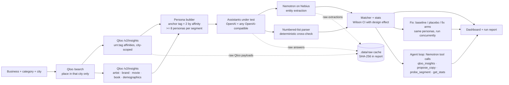

# TasteProbe

**Do AI assistants recommend you to your own audience?** TasteProbe builds personas from a venue's real Qloo taste neighbourhood, asks live AI assistants for recommendations as each persona, has an NVIDIA Nemotron model on Nebius extract what they recommended, and reports share of voice per taste segment with 95% intervals. It then tests fix copy against a placebo, either as one attempt or through a Nemotron tool-calling agent loop.

> **Status: not yet run end to end against live keys.** No Qloo, Nebius or assistant keys were available while building, so every live path ends at "Setup required: VAR" (HTTP 503 in the app, exit code 1 in the CLI). Nothing is simulated. See [What is unverified](#what-is-unverified-until-the-first-live-run).
>
> Demo video: _not recorded yet; needs keys_ (script in [docs/demo.md](docs/demo.md)).

## Architecture



| Stage | Where |
|---|---|
| Qloo search (city-only), tag and cross-domain insights | `src/lib/providers.ts`, `pickPlace` in `src/lib/taste.mjs` |
| Personas, prompts, placebo copy, brand matching | `src/lib/taste.mjs` |
| Wilson + design effect, paired lift bootstrap, arm comparison | `src/lib/stats.mjs` |
| Assistant fan-out, Nemotron extraction, failure kinds | `src/lib/probe.ts` |
| Numbered-list cross-check | `src/lib/extract.mjs` |
| Audit pipeline (shared by API and CLI) | `src/lib/audit.ts` |
| Three-arm fix experiment | `src/lib/experiment.ts`, `src/app/api/audits/[id]/fix/route.ts` |
| Agent loop (tool calling) and its pure stop/budget logic | `src/lib/agent.ts`, `src/lib/agent-core.mjs`, `src/app/api/audits/[id]/agent/route.ts` |
| Locked, atomic JSON store | `src/lib/filestore.mjs`, `src/lib/storage.ts` |
| Live CLI, report and replay | `scripts/live-audit.mjs`, `src/lib/report.mjs` |
| Dashboard | `src/app/page.tsx`, `src/components/*` |

## Setup

Node.js 22.18+ (the CLI loads the TypeScript pipeline with Node's built-in type stripping; the web app alone runs on Node 20).

```sh
npm install
cp .env.example .env.local   # then fill in the keys below
npm run dev                  # http://localhost:3000
```

| Variable | Required | Purpose |
|---|---|---|
| `QLOO_API_KEY` | yes | Qloo taste graph. `QLOO_BASE_URL` defaults to the hackathon host; set `https://api.qloo.com` for production keys. |
| `NEBIUS_API_KEY` | yes | Nebius Token Factory. `NEBIUS_MODEL` must be an NVIDIA model your key serves (default `nvidia/Nemotron-3-Nano-30B-A3B`). |
| `OPENAI_API_KEY` or `MODEL_2_*` | at least one | The assistants being audited. `MODEL_2_*` and `MODEL_3_*` take any OpenAI-compatible endpoint. |
| `NEBIUS_INPUT_PRICE_PER_MILLION`, `NEBIUS_OUTPUT_PRICE_PER_MILLION` | no | Your Nebius rates. Used for cost estimates and the agent's dollar cap (without them the cap is reported as unenforced). |
| `NEBIUS_MAX_TOKENS` | no | Nemotron `max_tokens` (default 8192, so reasoning is not cut off). |
| `NEBIUS_THINKING` | no | `on` / `off` sends `chat_template_kwargs.enable_thinking`. Unset sends nothing. See below. |

Keys are read only on the server. If one is missing, the header pill turns red, a **Setup required** panel names the variable, the Run buttons stay disabled, and the API answers `503` (the agent route returns `{"error":"setup_required","missing":[...]}`).

## One-command live run

```sh
npm run audit:live -- --brand "Exact listing name" --city Mumbai [--category restaurant] [--personas 24]
npm run audit:live -- --replay <run id>
```

1. **Preflight.** Each missing variable prints `Setup required: VAR` and the script exits 1 before any API call. Otherwise it makes the cheapest real call per key: Qloo `/search` with `take=1`, Nebius `/models` (the configured model must be listed), and each assistant's `/models` (or a 1-token completion).
2. **Run.** The same pipeline as the web app, with progress on stdout.
3. **Report.** `.data/reports/<id>.json` and `.html` record model IDs and hosts, temperature, Nemotron `max_tokens` and thinking setting, the persona and bootstrap seeds, the extraction prompt, every persona prompt, failure rates by cause and the SHA-256 of every raw file.
4. **Replay.** `--replay <id>` recomputes the numbers from the cached responses (no API calls), checks the raw-file hashes against the live report, and writes `<id>.replay.html` under a banner: "Replay of run <id> recorded <time>".

## How the numbers are made

1. **Venue.** Qloo `/search` must return a place whose address or geocode names the requested city. If none does, the audit stops and lists what Qloo found elsewhere. It never audits a namesake in another city.
2. **Personas.** Qloo `/v2/insights` (`filter.type=urn:tag`, `signal.interests.entities`, `signal.location.query`) returns up to 50 tags with affinity. Tags are grouped into segments by subtype. **Every segment gets at least 8 personas**: N personas allow at most floor(N/8) segments (max 6). Each persona anchors on one tag and adds two from other segments, sampled by affinity with seed 7. Where Qloo returns them, a persona also names one or two artists, brands, films or books with affinity to the venue.
3. **Prompts.** The **baseline** prompt holds only the persona's tastes, the category and the city. It never names the venue.
4. **Extraction.** Nemotron returns the venues each answer recommends as JSON. Output that is truncated at `max_tokens`, has no JSON or has no `entities` array is counted as **unparseable**. It is never silently turned into "not recommended". A deterministic numbered-list parser reads the same answer, and the audit reports how often the two disagree, per assistant.
5. **Denominators.** Share of voice is mentions / usable answers. Every segment also reports attempted answers and the dropped ones, split into assistant errors, unparseable extractions and failed extractions.
6. **Intervals.** 95% **Wilson** intervals on an **effective sample size**. A Kish design effect (cluster-robust variance over binomial variance, kept between 1 and answers-per-persona) accounts for one persona's answers across assistants being correlated. With no variation, the effective size is the number of personas, so 0 of 12 gives an upper bound of about 24%, not a 0–0% interval. A seeded simulation in the tests checks coverage of at least 90% at p = 0.03 and 0.3 with 8 personas.
7. **Fix experiment (placebo-controlled).** For the chosen segment, Nemotron writes one piece of copy. Every persona then asks every assistant **three ways at the same time**:
   - **baseline**: no snippet, re-run now, so model drift since the audit doesn't count as lift;
   - **placebo**: a neutral retrieved snippet, "<brand> is a <category> in <city>.";
   - **fix**: the proposed copy, injected exactly the same way.

   The headline lift is **fix − placebo**, a paired bootstrap over personas because both arms share them. Placebo − baseline is shown as the name-exposure effect. Every attempt is kept in `counterfactuals[]` and shown as a history.
8. **Agent loop.** Nemotron gets four tools: `qloo_insights` (live), `propose_copy` (rules enforced in code), `probe_segment(candidate_id, n)` (placebo vs fix on the next n personas) and `get_stats`. It plans, proposes, probes and revises. **The code decides when to stop**: as soon as a copy probed on at least 8 personas has a lift CI entirely above zero, or when the copy tries, assistant calls, Nemotron tokens, dollar cap or turns run out. Steps stream as NDJSON with tokens and cost. The run summary and the full trace (messages and every probe answer) are saved. The stop rule, budget accounting and best-candidate selection are pure functions with their own tests.

## Sponsor technology

- **Qloo (Qloo Agentic Hackathon):**
  - `/search` resolves the venue in its city and checks the rivals assistants recommend.
  - `/v2/insights` with `urn:tag` builds the personas.
  - `/v2/insights` with `urn:entity:artist|brand|movie|book` and `urn:demographics` adds cross-domain taste.
  - The agent reads Qloo live through its `qloo_insights` tool.
- **NVIDIA on Nebius (Nebius x NVIDIA):** a Nemotron open model on Nebius Token Factory does every extraction, writes fix copy and drives the tool-calling agent loop. Token usage and estimated cost are shown per audit and per agent step.

## What is unverified until the first live run

- **Qloo response shapes.** Parsing follows docs.qloo.com and accepts known variants. `urn:demographics` is not in Qloo's published `filter.type` list; its parser follows the shape community projects report. Each cross-domain call fails on its own and its error is stored.
- **Nemotron tool calling on Nebius.** Nebius documents OpenAI-style `tools` / `tool_choice` on chat completions. Whether the configured Nemotron build honours them there is only confirmed by a live call. A model that ignores tools ends the loop with `agent_finished`.
- **Thinking toggle.** NVIDIA's Nemotron 3 Nano card documents `chat_template_kwargs.enable_thinking`. Nebius documents `reasoning_effort` and accepts extra body fields. Neither mapping is confirmed on Nebius, so `NEBIUS_THINKING` is opt-in and unset by default. Reasoning length is read from `reasoning_content` or `<think>` blocks when present.
- **Rival verification.** "Verified in Qloo" means `/search` returned a place in the city whose name matches the rival.
- **Nebius prices.** These are not hard-coded. Set your own rates.

## Tests

`npm test` runs 50 tests. The table and what each file covers are in [TESTING.md](TESTING.md). The full check:

```sh
npm test && npm run typecheck && npm run lint:no-mock && npm run build
```

CI (`.github/workflows/ci.yml`) runs all four on Node 22. The fixtures in `test/fixtures` are hand-written to the documented shapes, used only by tests, and labelled as such. `lint:no-mock` fails if `src/` imports them.

## Limitations

- Personas are composites of Qloo taste signals, not real individuals or a representative panel.
- Assistants are queried through their APIs at temperature 0.7 without web browsing. Consumer apps with live search may answer differently.
- The fix experiment is prompt-level: it shows whether assistants would use the copy if they retrieved it, not whether a published change would be crawled.
- Intervals cover sampling over personas and answers. They don't cover extraction errors (the cross-check reports those separately) or the choice of prompt template.
- The agent's dollar cap covers Nemotron tokens at your configured rates. Assistant calls are capped by count.
- Storage is a local JSON file under `.data/` (mode 600). Writes are serialised in-process and atomic. Run one server per data directory. Serverless hosts need `TASTEPROBE_DATA_DIR` on a persistent volume and roughly 5-minute requests.

## License

MIT, Copyright (c) 2026 Nivesh Gajengi. See [LICENSE](LICENSE).
