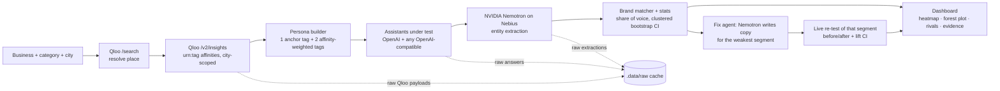

# TasteProbe

**Do AI assistants recommend you to your own audience?** TasteProbe builds personas from a venue's real Qloo taste neighbourhood, asks live AI assistants for recommendations as each persona, uses an NVIDIA open model on Nebius to extract what they recommended, and reports share of voice per taste segment with bootstrap confidence intervals. A fix agent then proposes copy for the weakest segment and re-tests it live.

> Demo video: _not recorded yet_ (see [docs/demo.md](docs/demo.md) for the script)

## Architecture



| Stage | Where |
|---|---|
| Qloo place search and tag insights | `src/lib/providers.ts` |
| Persona construction, brand matching, prompts | `src/lib/taste.mjs` |
| Bootstrap, clustered bootstrap, lift CI | `src/lib/stats.mjs` |
| Assistant fan-out and Nemotron extraction | `src/lib/probe.ts` |
| Streaming audit API (NDJSON progress) | `src/app/api/audits/route.ts` |
| Fix agent and counterfactual re-test | `src/app/api/audits/[id]/fix/route.ts` |
| Dashboard | `src/app/page.tsx`, `src/components/*` |

## Setup

Prerequisites: Node.js 20+.

```sh
npm install
cp .env.example .env.local   # then fill in the keys below
npm run dev                  # http://localhost:3000
```

| Variable | Required | Purpose |
|---|---|---|
| `QLOO_API_KEY` | yes | Qloo taste graph. `QLOO_BASE_URL` defaults to the hackathon host; set `https://api.qloo.com` for production keys. |
| `NEBIUS_API_KEY` | yes | Nebius Token Factory. `NEBIUS_MODEL` must be an NVIDIA model your key can serve (default `nvidia/Nemotron-3-Nano-30B-A3B`). |
| `OPENAI_API_KEY` or `MODEL_2_*` | at least one | The assistants being audited. `MODEL_2_*` and `MODEL_3_*` take any OpenAI-compatible endpoint. |
| `NEBIUS_INPUT_PRICE_PER_MILLION`, `NEBIUS_OUTPUT_PRICE_PER_MILLION` | no | Your Nebius rates, used to turn real token usage into a cost-per-audit estimate. |

Keys are read only on the server. If a key is missing, the header pill turns red, a **Setup required** banner names the missing variable, the Run button stays disabled, and the API returns `503` with the same message. If the configured Nebius model isn't in your key's `/v1/models` catalog, the banner lists the NVIDIA models that are.

## How the numbers are made

1. **Personas.** Qloo returns up to 50 tags with affinity to the venue, scoped to the city. If city coverage is thin, the venue's global tags are added and both payloads are cached. Tags are grouped into segments by Qloo tag subtype. Each persona anchors on one tag from its segment and adds two tags from other segments, sampled by affinity with a fixed seed so runs are reproducible.
2. **Prompts.** The assistant sees only the persona's tastes, the category and the city, never the target brand.
3. **Extraction.** Nemotron returns the venues each answer recommends as JSON. A tolerant parser handles reasoning-model output.
4. **Matching.** Names match after normalising case, accents, articles, possessives and `&`. Branch suffixes match, but bare generic fragments like "Canteen" don't.
5. **Stats.** Share of voice is the share of answers that mention the brand. Overall and per-segment 95% CIs use a **persona-clustered** percentile bootstrap, because one persona's answers across assistants are correlated. Per-assistant cells use the same method within that assistant.
6. **Fix agent.** Nemotron writes one piece of copy for a chosen segment (by default the weakest). Every persona in that segment re-asks every assistant with the copy injected as retrieved web context. The result shows before vs. after, a CI for the after share and a bootstrap CI for the lift, with a plain-language verdict.

## Sponsor technology

- **Qloo (Qloo Agentic Hackathon):** `/search` resolves the venue to a Qloo entity, and `/v2/insights` with `filter.type=urn:tag`, `signal.interests.entities` and `signal.location.query` supplies the taste graph every persona is built from. The dashboard shows each persona's Qloo tags and affinity scores.
- **NVIDIA on Nebius (Nebius × NVIDIA hackathon):** an NVIDIA Nemotron open model served by Nebius Token Factory does all extraction and writes the fix copy. The dashboard shows the model ID, real token usage and estimated cost per audit.

## Tests

```sh
npm test            # node:test, covering stats, persona building, brand matching, JSON parsing
npm run typecheck
npm run lint:no-mock  # fails if src/ contains mock/fake/dummy/lorem/TODO or imports test fixtures
npm run build
```

CI (`.github/workflows/ci.yml`) runs all four on every push. The fixtures in `test/fixtures` are used only by tests.

## Limitations

- **Not yet run end to end against live keys from this repo.** No keys were available while building, so the Qloo response parsing follows the documented `/v2/insights` shape and accepts known variants (`results.tags` or `results.entities`, `query.affinity` or `affinity`). Check the first live audit's `.data/raw/<id>/qloo.json`.
- Personas are composites of Qloo taste tags, not real individuals or a representative panel. Segment sizes follow how many tags Qloo returns per subtype.
- Assistants are queried through their APIs at temperature 0.7, without web browsing. Consumer apps with live search may answer differently.
- The counterfactual is prompt-level: it shows whether assistants would pick up the copy if they retrieved it, not whether a published site change would be crawled. The "before" arm is the cached baseline, so model drift between runs is not controlled.
- CIs capture sampling variation over personas and answers only. They don't cover extraction errors or the choice of prompt template.
- Storage is a local JSON file under `.data/` (mode 600). Serverless hosts need `TASTEPROBE_DATA_DIR` on a persistent volume, and long audits need a host that allows roughly 5-minute requests.

## License

MIT
