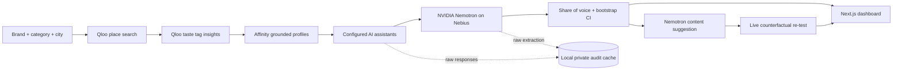

# TasteProbe

**See how AI assistants recommend your business to people who share their taste.** TasteProbe grounds audience profiles in Qloo affinities, asks configured assistants for real recommendations, and uses NVIDIA Nemotron through Nebius to extract and measure them.

## Architecture



## Setup

Prerequisites: Node.js 20 or newer and npm.

```sh
npm install
cp .env.example .env.local
# Add keys to .env.local, then:
npm run dev
```

Open <http://localhost:3000>. API keys are read by the Next.js server only and are never returned to the browser. An audit requires a Qloo key, a Nebius Token Factory key for Nemotron extraction, and at least one tested assistant. Configure OpenAI or an OpenAI-compatible endpoint in `.env.local`:

```dotenv
QLOO_API_KEY=...
NEBIUS_API_KEY=...
NEBIUS_MODEL=nvidia/Nemotron-3-Nano-30B-A3B
NEBIUS_BASE_URL=https://api.tokenfactory.nebius.com/v1
OPENAI_API_KEY=...
OPENAI_MODEL=gpt-4o-mini
```

For up to two additional assistants, set `MODEL_2_API_KEY`, `MODEL_2_BASE_URL`, `MODEL_2_ID`, and optionally `MODEL_2_NAME`; repeat with `MODEL_3_*` for a third tested system. You can use any provider with an OpenAI-compatible chat completions API. The server status panel displays which connections are configured. A missing key or provider error is shown as an error; results are never substituted.

## Demo script

1. Add the Qloo, Nebius, and one tested assistant key to `.env.local`; restart the server.
2. Enter a real restaurant listing, category, and city (the form starts with The Bombay Canteen in Mumbai as editable input, not preloaded data). Choose a small cohort for the live demo.
3. Run the audit. Show the Qloo affinity tags, actual model/system names, observed recommendation counts, share-of-voice estimates, and bootstrap confidence intervals.
4. Expand the raw audit cache locally if needed to show the underlying real answers and Nebius extraction responses.
5. Run “Generate & re-test” to have Nemotron propose a content change and re-query the same taste segment. Show the suggestion and measured before/after responses, including the interval. This is a prompt-level counterfactual; it does not publish a site change.

## Sponsor technology

- **Qloo Agentic Hackathon:** Qloo `/search` resolves the requested business; Qloo `/v2/insights` fetches city-scoped tag affinities.
- **Nebius × NVIDIA:** Nemotron on Nebius Token Factory extracts entities and proposes a content change. Set `NEBIUS_MODEL` to an NVIDIA model available to your Nebius key.

## Validation

```sh
npm test
npm run build
```

## Limitations

- Persona profiles are affinity-tag profiles derived from real Qloo responses; they are not identified individual people or a panel of 200 known consumers.
- The number of profiles returned depends on the Qloo account’s coverage and the tags returned for the place and city. The audit reports actual counts.
- A default run asks each configured tested assistant once per returned profile. Up to three tested systems are configurable. Provider quotas and latency constrain cohort size; start small and cache completed audits.
- Bootstrap intervals describe variation in the observed responses. They do not establish causal lift or represent all consumers.
- The counterfactual injects a suggested content change into a new live assistant prompt. It does not edit or crawl the business website, and no improvement is guaranteed.
- Audits and raw model/provider responses are cached locally under `.data/` with restrictive file permissions. Back up or remove this directory according to your retention policy. A multi-instance deployment needs shared durable storage and job orchestration.
- No demo video link is available yet.
